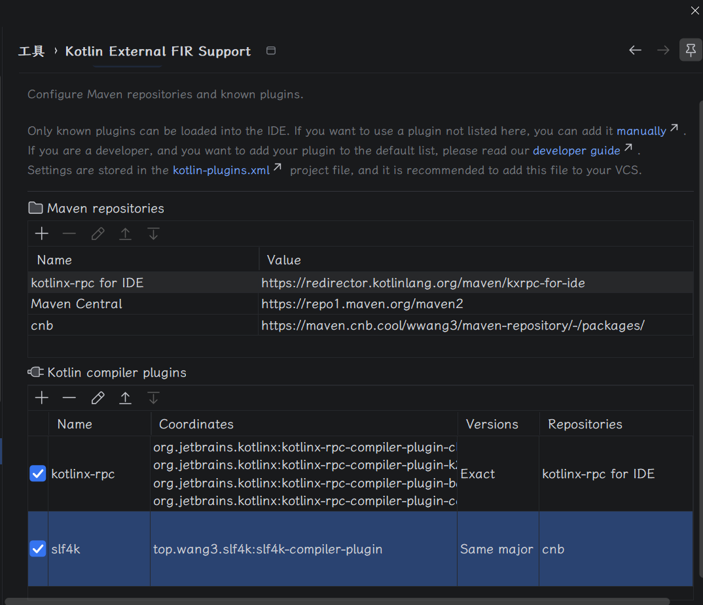

# slf4k

`slf4k` 是一个 Kotlin 编译器插件，通过 `@Slf4k` 注解自动为类与 object 生成 slf4j `Logger`，
消除手写 `private val logger = LoggerFactory.getLogger(Foo::class.java)` 的样板代码。

```kotlin
import top.wang3.slf4k.Slf4k

@Slf4k
class UserService {
    fun greet(name: String) {
        logger.info("hello {}", name)   // logger 由插件在 companion object 上生成
    }
}

@Slf4k
object UserRegistry {
    fun load() {
        logger.info("loading")          // object 没有 companion，logger 直接生成在 object 自身
    }
}
```

生成效果（概念等价）：

```kotlin
class UserService {
    fun greet(name: String) { logger.info("hello {}", name) }

    companion object {
        private val logger: Logger = LoggerFactory.getLogger("com.example.UserService")
    }
}

object UserRegistry {
    private val logger: Logger = LoggerFactory.getLogger("com.example.UserRegistry")

    fun load() { logger.info("loading") }
}
```

## 模块

| 模块 | 作用 |
| --- | --- |
| `slf4k-annotations` | `@Slf4k` 注解定义 |
| `slf4k-compiler-plugin` | FIR + IR 编译期插件实现 |
| `slf4k-gradle-plugin` | Gradle 插件胶水层（`KotlinCompilerPluginSupportPlugin`） |
| `slf4k-gradle-plugin-functional-test` | Gradle 插件端到端功能测试（GradleRunner） |

## 接入方式

### 1. Gradle 插件（推荐）

```kotlin
plugins {
    kotlin("jvm") version "2.4.20"
    id("top.wang3.slf4k") version "2.4.20-0.0.4"
}

// 可选：覆盖生成的 logger 属性名，默认 "logger"
slf4k {
    loggerName.set("log")
}

dependencies {
    implementation("org.slf4j:slf4j-api:2.0.18")
    runtimeOnly("org.slf4j:slf4j-simple:2.0.18")
    // slf4k-annotations 由 Gradle 插件自动注入到 implementation 配置，无需手写
}
```

> Gradle 插件坐标采用 `<kotlin>-<slf4k>` 格式（与下文 compiler-plugin 同规则），用户从 `version` 字段即可看到插件适配的 Kotlin 版本。

### 2. 编译器插件直挂（仅在无法使用 Gradle 插件时使用）

```kotlin
import org.jetbrains.kotlin.gradle.tasks.KotlinCompile

dependencies {
    implementation("top.wang3.slf4k:slf4k-annotations:0.0.4")
    implementation("org.slf4j:slf4j-api:2.0.18")
}

tasks.withType<KotlinCompile>().configureEach {
    compilerOptions {
        // compiler-plugin 坐标是 <kotlinVersion>-<slf4kVersion>（KEFS 规则），例如 2.4.20-0.0.4
        freeCompilerArgs.add("-Xplugin=/path/to/slf4k-compiler-plugin-2.4.20-0.0.4.jar")
        // 可选：自定义 logger 属性名
        freeCompilerArgs.addAll(
            "-P", "plugin:top.wang3.slf4k.compiler:logger-name=log",
        )
    }
}
```

## IDE 支持（KEFS）

Kotlin IDE 插件（2026.1 起）并没有对外稳定的 `firExtensionRegistrar` 扩展点，第三方 IDEA 插件
无法直接把 FIR 扩展塞进 K2 Analysis API。因此推荐用户安装社区方案
[**KEFS (Kotlin External FIR Support)**](https://plugins.jetbrains.com/plugin/27480-kotlin-external-fir-support)，
让 IDE 复用编译器插件 jar 来驱动补全 / 跳转 / 引用解析。

### 安装步骤

1. IDEA 开启 **K2 Mode**（Settings → Languages & Frameworks → Kotlin → Enable K2 Mode）；
   K1 模式下 FIR 扩展点不会触发，这是 JetBrains 的限制。
2. 从 JetBrains Marketplace 搜索安装 **Kotlin External FIR Support**。
3. 正常打开接入 `top.wang3.slf4k` 的 Gradle 项目并 sync。KEFS 会按坐标规则
   `<idea-kotlinc-version>-<slf4kVersion>` 从 `dependencies` 自动加载
   `slf4k-compiler-plugin` 并将其 FIR 扩展注册到 IDE 会话。

### 坐标约定

为了让 KEFS 按 IDE 捆绑 Kotlin 版本匹配到正确的 jar，`slf4k-compiler-plugin` 与
`slf4k-gradle-plugin` 的发布坐标都采用 `<kotlin>-<slf4k>` 格式：

```
top.wang3.slf4k:slf4k-compiler-plugin:<idea-kotlinc-version>-<slf4kVersion>
top.wang3.slf4k:slf4k-gradle-plugin:<idea-kotlinc-version>-<slf4kVersion>
# 例：Kotlin 2.4.20 + slf4k 0.0.4 →
top.wang3.slf4k:slf4k-compiler-plugin:2.4.20-0.0.4
top.wang3.slf4k:slf4k-gradle-plugin:2.4.20-0.0.4
```

Gradle 插件在运行时会通过 `Slf4kPluginCoordinates` 自动把 compiler-plugin `SubpluginArtifact`
版本指向 `<kotlin>-<slf4k>`，annotations 依赖指向 slf4k semver，用户 **无需** 手动改引用。

### KEFS 插件配置


### 已知限制

- KEFS 通过反射的**无参构造器**实例化 `Slf4kFirExtensionRegistrar`。当前实现下，IDE 会话中
  `loggerName` 只会使用默认值 `logger`；Gradle 中自定义的 `slf4k { loggerName.set("log") }`
  对编译器生效，但 IDE 不会感知，`log.info(...)` 仍会红。想在 IDE 侧也生效，暂时保持默认
  `loggerName`。
- IDEA 2026.1 下 K2 在文件变更后可能丢失 FIR 合成声明，参见
  [KT-84711](https://youtrack.jetbrains.com/issue/KT-84711)；JetBrains 预计在 2026.1.1 修复，
  目前若症状明显可留在 IDEA 2025.1 / 2025.3。

## 行为细节

- `@Slf4k` 对 `class`、`enum class` 与 `object`（含 `data object`、嵌套 object）生效；
  不支持 `interface`、`annotation class` 以及显式标注的 `companion object`。
- `class` / `enum class` 的 logger 生成在 companion object 上：缺失时自动生成 companion，
  已有 companion 时只追加属性，不会替换它。`object` 的 logger 直接生成在 object 自身成员上，
  且不会为 object 生成 companion。
- 若目标自身（`class` 还包括其 companion object）已经存在与 `loggerName` 同名的属性，插件会以
  ERROR 终止编译，避免静默覆盖。
- 生成的 logger 为 `private val`，只能在被标注目标内部使用；category 为被标注目标的 Kotlin FQN
  （嵌套类 / 嵌套 object 使用点号分隔，如 `com.example.Outer.Inner`）。

## 构建与测试

```bash
./gradlew build                              # 全量构建
./gradlew :slf4k-test:test                   # 编译器插件集成测试
./gradlew :slf4k-gradle-plugin:check         # Gradle 插件发布模块检查
./gradlew :slf4k-gradle-plugin-functional-test:test  # Gradle 插件功能测试（GradleRunner）
```

## 多 Kotlin 版本支持

全局 Kotlin 版本由 `gradle/libs.versions.toml` 的 `kotlin` 变量统一控制——KGP、
`kotlin-compiler-embeddable` 与 compiler-plugin / gradle-plugin 的坐标都从它派生。
必须与目标 IDE 捆绑的 kotlinc 保持一致（KEFS 要求 + 编译期 API 对齐）。

临时切版（命令行覆盖，不改 `libs.versions.toml`）：

```bash
./gradlew :slf4k-compiler-plugin:build -Pkotlin.version=2.4.0-dev-2631
# 产出 slf4k-compiler-plugin-2.4.0-dev-2631-0.0.4.jar
```

CI 矩阵可并行跑多个 `-Pkotlin.version=X` 产出多份 compiler-plugin / gradle-plugin artifact；

## 关键坐标

- group: `top.wang3.slf4k`
- slf4k semver: `0.0.4`（= `slf4k-annotations` 版本、`<kotlin>-<slf4k>` 中的 `<slf4k>` 部分）
- compiler-plugin 坐标: `slf4k-compiler-plugin:2.4.20-0.0.4`（KEFS 规则 `<kotlin>-<slf4k>`）
- gradle-plugin 坐标: `slf4k-gradle-plugin:2.4.20-0.0.4`（同规则；`plugins {}` 里用户可见）
- Kotlin: `2.4.20`（= IDE 捆绑 kotlinc 版本，可用 `-Pkotlin.version=X` 覆盖）
- slf4j: `2.0.18`
- Gradle 插件 ID: `top.wang3.slf4k`
- 编译器插件 ID: `top.wang3.slf4k.compiler`
- CLI option: `logger-name`（必须是合法 Kotlin 标识符）
